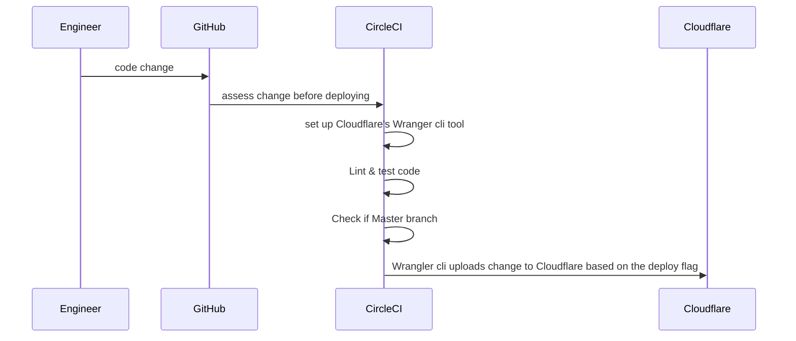
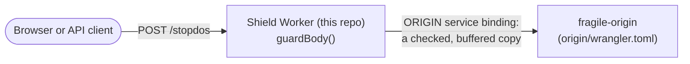
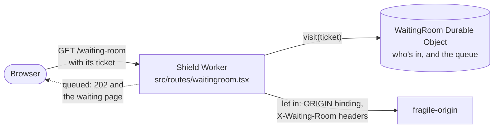

## Cloudflare Worker

[](https://dl.circleci.com/status-badge/redirect/gh/Rusty-Magnet-Ltd/cloudflare_worker/tree/master)

Code powers [foobar.rustymagnet.xyz](https://foobar.rustymagnet.xyz/).

<!-- TOC -->

- [Cloudflare Worker](#cloudflare-worker)
- [DoS shield: /stopdos](#dos-shield-stopdos)
  - [What the shield checks](#what-the-shield-checks)
  - [Turn the shield off](#turn-the-shield-off)
  - [Run the demo](#run-the-demo)
  - [Lock down the origin](#lock-down-the-origin)
- [Waiting room: /waiting-room](#waiting-room-waiting-room)
  - [How the queue works](#how-the-queue-works)
  - [Turn the queue off](#turn-the-queue-off)
  - [Try it](#try-it)
  - [Limits](#limits)
- [Learnings](#learnings)
  - [Time](#time)
  - [Testing](#testing)
    - [Vitest Version](#vitest-version)
    - [Proxy](#proxy)
    - [Environment Variables](#environment-variables)
    - [Secrets](#secrets)
  - [Environment](#environment)
    - [Where](#where)
    - [Pass environment to tests](#pass-environment-to-tests)
    - [Deploy](#deploy)
  - [Debug](#debug)
    - [tail](#tail)
    - [logs](#logs)
  - [Workflows](#workflows)
- [Architecture](#architecture)
  - [End-2-End deployment workflow](#end-2-end-deployment-workflow)
  - [Design choices](#design-choices)

<!-- /TOC -->


## Set up

### End-2-End deployment workflow




## DoS shield: /stopdos

Some services have no DoS protection of their own; in production, bodies over 1 MiB crashed them. `/stopdos` shows a Worker standing in front of such a service, middleware style, so oversized or malformed bodies never reach it. `fragile-origin` (in `origin/`) plays the service: it reads every body in full and "crashes" (500) above 100 bytes. The demo uses 100 bytes for both that crash point and the shield's cap so you can trip it by hand; in front of a real service, set the cap to what that service can take.



`fragile-origin` has `workers_dev = false`, `preview_urls = false` and no routes, so it has no address on the internet. The `ORIGIN` binding is the only way in.

### What the shield checks

`guardBody()` (`src/middleware/guardbody.ts`) never trusts `Content-Length`:

| Request | Shield answers | Reaches the origin? |
|---|---|---|
| `Content-Length` malformed (`abc`, `-1`, `1e3`) or repeated (`16, 16`) | 400 | No |
| `Content-Length` and `Transfer-Encoding` together | 400 | No |
| `Content-Length` over 100 bytes | 413, without reading the body | No |
| More than 100 bytes actually arrives | 413 as soon as byte 101 arrives, and the stream is cancelled | No |
| Bytes received differ from `Content-Length` | 400 | No |
| Body still arriving after `BODY_DEADLINE_MS` | 408 | No |
| Everything else | The origin's own response | Yes: exactly the checked bytes, re-framed by the runtime |

Errors are a page for `Accept: text/html` and JSON (`{error, limit, declared, received}`) otherwise. The origin's 303 to its good page goes back to the browser rather than being followed by the shield.

`hono/body-limit` isn't used on this path: it trusts a `Content-Length` under the cap and then lets the handler read the stream unbounded, its `parseInt` accepts `abc` and `5, 5`, and it has no deadline.

### Turn the shield off

If the shield itself misbehaves, for example by refusing bodies it should let through, `STOPDOS_SHIELD` turns it off. Set to `off`, POSTs go to `fragile-origin` exactly as the client sent them, the way GETs already do. Any other value, or none, leaves the shield on, so a typo can't turn it off. While it's off nothing protects the origin: bodies over 100 bytes crash it again, and every unchecked POST logs a warning (`stopdos shield is off ...`).

- **Fastest, no pull request.** In the Cloudflare dashboard, open Workers & Pages → `foo` → Settings → Variables and Secrets, set `STOPDOS_SHIELD` to `off` and deploy. The next deploy from CircleCI (any merge to `master`) puts back the value in `wrangler.toml`, so if the shield has to stay off, change it there too.
- **Through Git.** Set `STOPDOS_SHIELD = "off"` under `[env.production.vars]` in `wrangler.toml` and merge.

Turn it back on the same way, with `on`. To see which way it's set, send 101 bytes: 413 means the shield is on, and 500 (the origin crashing) means it's off.

```sh
head -c 101 /dev/zero | curl -s -o /dev/null -w '%{http_code}\n' --data-binary @- https://foobar.rustymagnet.xyz/stopdos
```

### Run the demo

```sh
npm run demo:dos
```

It starts both Workers under `wrangler dev` (ports 8820-8823; override with `SHIELD_PORT`, `ORIGIN_PORT`, `SHIELD_INSPECTOR_PORT`, `ORIGIN_INSPECTOR_PORT`), sends each case with curl, and stops them:

```
REQUEST                                      STATUS      WHAT FRAGILE-ORIGIN RECEIVED
200 bytes straight to the origin (no shield) 500         POST /stopdos content-length=200 transfer-encoding=- received=200
200 bytes via the shield, Content-Length     413         nothing
26 bytes sent, Content-Length: 10            200         POST /stopdos content-length=10 transfer-encoding=- received=10
10 bytes sent, Content-Length: 100           408         nothing
small form via the shield, curl -L           303 -> 200  POST /stopdos content-length=13 transfer-encoding=- received=13;GET /stopdos/thanks content-length=- transfer-encoding=- received=0
200 bytes via the shield, chunked, no length 413         nothing
```

Locally the origin also listens on a port of its own, which it never has when deployed. The first row uses it to show what an attacker gets when a service can be reached without the shield.

To click through the form instead, run `npm start` and `npm run start:origin` side by side and open `http://localhost:8787/stopdos`. The shield finds the origin through wrangler's dev registry.

### Lock down the origin

If the service is reachable directly, attackers skip the Worker. `fragile-origin` is safe only because it has no address at all. A real service that isn't a Worker does have one, so close every way to it that doesn't go through the shield, including DNS-only records and old hostnames that expose its IP:

- **Cloudflare Tunnel.** `cloudflared` runs next to the service and makes outbound-only connections to Cloudflare, so the service needs no public IP or open inbound port. Protect the tunnel's hostname with a Cloudflare Access policy that admits only the shield (for example, a service token the Worker sends), or that hostname becomes the new way around.
- **Authenticated Origin Pulls (mTLS).** The service accepts only TLS connections that present a client certificate. Use zone-level or per-hostname AOP with a certificate you upload: global AOP's certificate is shared across all Cloudflare accounts, so it only proves a request came from the Cloudflare network, not from your account ([docs](https://developers.cloudflare.com/ssl/origin-configuration/authenticated-origin-pull/)). Whether a Worker's own `fetch()` presents the AOP certificate isn't covered there; test it. A Worker can present a client certificate itself through an [`mtls_certificates` binding](https://developers.cloudflare.com/workers/runtime-apis/bindings/mtls/), but not toward a proxied zone on Cloudflare.
- **IP allowlist plus a secret header.** Firewall the service to [Cloudflare's IP ranges](https://developers.cloudflare.com/fundamentals/concepts/cloudflare-ip-addresses/), and have the shield add a secret header (stored as a Worker secret) that the service checks. Those ranges are shared by every proxied hostname, so the allowlist alone also admits other Cloudflare customers' traffic. The secret is what proves the request came from your shield.


## Waiting room: /waiting-room

Cloudflare's [Waiting Room](https://developers.cloudflare.com/waiting-room/) queues visitors when a site gets busier than its origin can take. It's only on Business and Enterprise plans, and it only starts queueing above 200 active visitors, so it can't run on this zone, and on any plan it's hard to try by hand. `/waiting-room` is a small one built from the parts Cloudflare built Waiting Room on, [Workers and Durable Objects](https://blog.cloudflare.com/building-waiting-room-on-workers-and-durable-objects/), both of which the Free plan includes.

`fragile-origin` takes 2 visitors at a time. A visitor who's let in has their request sent on to it. Everyone else queues, first come, first served, on a page that reloads itself until it's their turn.



### How the queue works

- **The ticket.** Each visitor gets a random ID in a cookie (`waiting-room`: `HttpOnly`, `SameSite=Lax`, path `/waiting-room`). It's only a name. Every decision lives in the Durable Object, so there's nothing in the cookie to forge, and a visitor who drops it just joins the back of the queue as someone new.
- **The room.** One Durable Object per hostname holds who's in and the queue. A Durable Object has a single instance worldwide, so visitors at every Cloudflare location share one count.
- **Capacity.** `WAITING_ROOM_CAPACITY` (default 2) visitors can be in at once. Each gets `WAITING_ROOM_STAY_SECONDS` (default 30) from when they're let in, and visiting again doesn't renew it. Nobody can stay for ever, so the queue moves at a known pace and the estimated wait holds.
- **The queue.** When a slot frees up, it goes to whoever is nearest the front, so reloading more often doesn't jump the queue. The waiting page reloads every 5 seconds, or sooner when a slot is due. A visitor who hasn't reloaded for 20 seconds has left, and loses their place. Past 1,000 waiting, new visitors get a 503 page saying the queue is full.
- **What reaches the origin.** An admitted visitor's request goes over the `ORIGIN` binding with `X-Waiting-Room: admitted`, `X-Waiting-Room-Capacity` and `X-Waiting-Room-Seconds-Left` headers. The shield drops any `X-Waiting-Room` headers a client sends, so `fragile-origin`, which only the shield can reach, can trust them.

| | Cloudflare Waiting Room | `/waiting-room` |
|---|---|---|
| Plans | Business (one room) and Enterprise | Any, including Free |
| Starts queueing | Above 200 active visitors | Above `WAITING_ROOM_CAPACITY` (2) |
| A visitor's time inside | 1 to 30 minutes after their last request, renewed on each one; only Enterprise can turn renewal off | `WAITING_ROOM_STAY_SECONDS` (30) from when they're let in, never renewed |
| Queue order | First come, first served; Enterprise can add others | First come, first served |
| Page while queued | Cloudflare's, with status 200 by default; custom pages are an Enterprise add-on | This repo's, with status 202 |

### Turn the queue off

If the queue itself misbehaves, `WAITING_ROOM_QUEUE` turns it off. Set to `off`, every visitor goes straight to `fragile-origin`, however many there are, and each one logs a warning (`waiting room queue is off ...`). Any other value, or none, keeps the queue on, so a typo can't turn it off. It's changed the same two ways as the shield's switch: in the dashboard (Workers & Pages → `foo` → Settings → Variables and Secrets), until the next deploy from CircleCI puts back the value in `wrangler.toml`, or in `wrangler.toml` itself.

If the Durable Object can't be reached, the shield lets visitors in and logs an error (`waiting room unavailable ...`), rather than keep everyone out.

To see which way it's set, open `/waiting-room`. "You're in" or the waiting page means the queue is on. "You came straight in" means it's off, or broken, and the page says which.

### Try it

Open `/waiting-room` in three browsers, or in normal and private windows, which don't share cookies. The first two are let in. The third waits until the first two visitors' 30 seconds are up, then gets in. From a terminal, give each visitor a cookie jar of its own:

```sh
for v in a b c; do curl -s -o /dev/null -w "$v %{http_code}\n" -c "/tmp/waiting-room-$v" -b "/tmp/waiting-room-$v" https://foobar.rustymagnet.xyz/waiting-room; done
```

200 means let in and 202 means queued. Everyone on the site shares the room, so you may queue behind strangers.

Locally, run `npm start` and `npm run start:origin` side by side and open `http://localhost:8787/waiting-room`.

### Limits

- The room lives in the Durable Object's memory. When the object restarts, after a deploy or a while with no visitors, it forgets everyone, and visitors who come back join again.
- Every page load, including each reload while queued, is a Worker request and a Durable Object request. On the Free plan, that's from 100,000 of each a day ([Durable Objects pricing](https://developers.cloudflare.com/durable-objects/platform/pricing/)).
- A client that doesn't keep cookies, like most scripts, gets a new ticket on every request. It joins the back of the queue each time, and drops out 20 seconds later.


## Learnings

### Time

Careful using `Date` outside a `route`.  Your dev machine will work as expected but the Cloudflare Worker won't.

```typescript
let epochDatee = Date.now();  // always zero / `1970-01-01` 

addEventListener("fetch", event => {
    let localDate = Date.now(); // expected time and date
})
```

### Testing

#### Vitest Version

Cloudflare is often Major versions behind in `vitest`.  You cannot just upgrade.

```shell
npm view @cloudflare/vitest-pool-workers@0.12.11 peerDependencies
{
  '@vitest/runner': '2.0.x - 3.2.x',
  '@vitest/snapshot': '2.0.x - 3.2.x',
  vitest: '2.0.x - 3.2.x'
}

# to stop all fo the errors use the `--save-exact`:
npm i -D vitest@~3.2.0 @cloudflare/vitest-pool-workers --save-exact

```
A written [here](https://developers.cloudflare.com/workers/testing/vitest-integration/get-started/write-your-first-test/).  If you upgraded, all the tests failed.


#### Proxy

> [!CAUTION]
> Expect hard to debug errors if there are tools on your machine proxying client connections or intercepting DNS queries.


#### Environment Variables

Testing required `"cloudflare:test"` to access `environment variables` in tests:

```typescript
import { env } from "cloudflare:test";

it("/generate signs a token", async () => {
    const res = await app.request("/generate", {}, env);
    expect(res.status).toBe(201);
});
```

#### Secrets

Local code uses a file named `.dev.vars` to read secret environment variables.  The normal `.env` file is used by Cloudflare code.

### Environment

#### Where

Environment specific values can be set in the `wrangler.toml` file as below; these can be source controlled safely as these are overridden locally by the .devs.vars ( local tests ) and production secrets.

```yaml
[env.testing.vars]
  SECURITY_HEADER_NAME = "X-Header"
  SECRET_KEY = "dummy"
  ENVIRONMENT = "TESTING"
```

#### Pass environment to tests

The environment setting can be fed to vitest: `wrangler: { configPath: "./wrangler.toml", environment: "testing" }`

#### Deploy

> [!CAUTION]
> Always set the correct `deploy flag` when uploading the Cloudflare `npx wrangler deploy -e prod`.  Get this wrong and you can override real production secrets.

> [!INFO]
Cloudflare suggest [here](https://developers.cloudflare.com/workers/wrangler/configuration/) treating your wrangler.toml file as the source of truth for your Worker configuration.

### Debug

#### tail

`console.log()` output is available.  Use the `tail` command in the cli tool.  This also outputs Cloudflare added headers like cf-ipcountry, asn, ray-id, True IP.

```shell
wrangler tail foo

```

#### logs

When errors happened inside a Worker, the output to the console was limited:

```shell
[ERROR] Uncaught (async) Error: internal error
```

But the logs helped:

```shell
Logs were written to "/<home>/.wrangler/logs/wrangler-2024-11-16.log"
DNS lookup failed.
```

### Workflows

You could start a backend workflow using a `workflow`; this was written using `QStash` from `Upstash`.  

To test it locally, `ngrok` was used to route all of the Worker requests via ngrok.  So you no longer went to `localhost:8787/waiting-room`.  Instead you used: `https://abcd.ngrok-free.app/waiting-room`

> [!CAUTION]
> This wouldn't work when other software were proxying client connections.

```shell
# start ngrok
ngrok http localhost:3001 --log=stdout

# set local environment .dev.vars
QSTASH_TOKEN="xxxx"
UPSTASH_WORKFLOW_URL="https://abcd.ngrok-free.app"

# inspect state of requests or local tunnelling
http://localhost:4040/inspect/http
http://localhost:4040/status
```


### Design choices

- Started on [itty-router](https://itty.dev/itty-router). But docs and testing were clearer with [Hono](https://hono.dev/guides/examples).
- Every HTML page, on both Workers, uses one shell (`src/views/page.ts`) and one stylesheet (`public/static/site.css`), in the same design as [rustymagnet.xyz](https://rustymagnet.xyz/). The shield serves the stylesheet as a static asset; `fragile-origin`'s pages link to it too, because browsers only reach them through the shield.
- The waiting room's rules (`src/waitingroom/room.ts`) are plain TypeScript with the clock passed in, so tests can move time on without waiting. The Durable Object (`src/waitingroom/durable.ts`) only wraps them.
- The app used `Grouping` of routers to slim down code into discrete files.  Link [here](https://hono.dev/docs/api/routing).
- Local dev connects to `ngrox` tunnelling.
- Setting the `ENVIRONMENT` variable needs to be handled; a great article [here](https://www.raulmelo.me/en/blog/best-practices-for-handling-per-environment-config-js-ts-applications)
- A [Boilerplate](https://github.com/marcosrjjunior/hono-boilerplate/tree/main/src/routes) on structuring project.
- The JWT work was based these [helpers](https://hono.dev/helpers/jwt).
