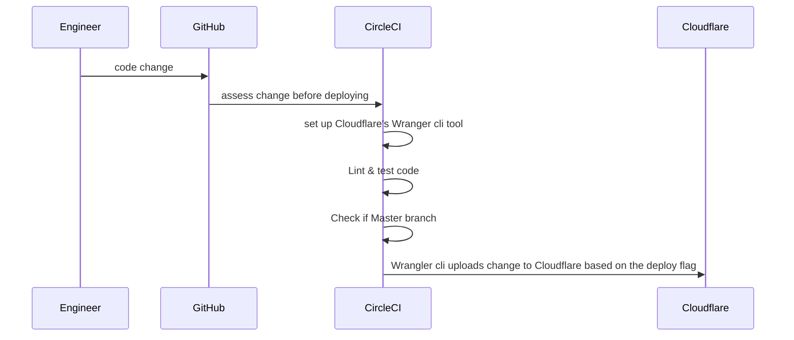

## Cloudflare Worker

[](https://dl.circleci.com/status-badge/redirect/gh/Rusty-Magnet-Ltd/cloudflare_worker/tree/master)

Code powers [foobar.rustymagnet.xyz](https://foobar.rustymagnet.xyz/).

<!-- TOC -->

- [Cloudflare Worker](#cloudflare-worker)
- [DoS shield: /stopdos](#dos-shield-stopdos)
  - [What the shield checks](#what-the-shield-checks)
  - [Run the demo](#run-the-demo)
  - [Lock down the origin](#lock-down-the-origin)
- [Learnings](#learnings)
  - [Time](#time)
  - [Testing](#testing)
    - [Vitest Version](#vitest-version)
    - [Proxy](#proxy)
    - [Environment Variables](#environment-variables)
    - [Secrets](#secrets)
  - [Environment](#environment)
    - [Where](#where)
    - [Pass environment to tests](#pass-environment-to-tests)
    - [Deploy](#deploy)
  - [Debug](#debug)
    - [tail](#tail)
    - [logs](#logs)
  - [Workflows](#workflows)
- [Architecture](#architecture)
  - [End-2-End deployment workflow](#end-2-end-deployment-workflow)
  - [Design choices](#design-choices)

<!-- /TOC -->


## Set up

### End-2-End deployment workflow




## DoS shield: /stopdos

Some services have no DoS protection of their own; in production, bodies over 1 MiB crashed them. `/stopdos` shows a Worker standing in front of such a service, middleware style, so oversized or malformed bodies never reach it. `fragile-origin` (in `origin/`) plays the service: it reads every body in full and "crashes" (500) above 100 bytes. The demo uses 100 bytes for both that crash point and the shield's cap so you can trip it by hand; in front of a real service, set the cap to what that service can take.


`fragile-origin` has `workers_dev = false`, `preview_urls = false` and no routes, so it has no address on the internet. The `ORIGIN` binding is the only way in.

### What the shield checks

`guardBody()` (`src/middleware/guardbody.ts`) never trusts `Content-Length`:

| Request | Shield answers | Reaches the origin? |
|---|---|---|
| `Content-Length` malformed (`abc`, `-1`, `1e3`) or repeated (`16, 16`) | 400 | No |
| `Content-Length` and `Transfer-Encoding` together | 400 | No |
| `Content-Length` over 100 bytes | 413, without reading the body | No |
| More than 100 bytes actually arrives | 413 as soon as byte 101 arrives, and the stream is cancelled | No |
| Bytes received differ from `Content-Length` | 400 | No |
| Body still arriving after `BODY_DEADLINE_MS` | 408 | No |
| Everything else | The origin's own response | Yes: exactly the checked bytes, re-framed by the runtime |

Errors are a page for `Accept: text/html` and JSON (`{error, limit, declared, received}`) otherwise. The origin's 303 to its good page goes back to the browser rather than being followed by the shield.

`hono/body-limit` isn't used on this path: it trusts a `Content-Length` under the cap and then lets the handler read the stream unbounded, its `parseInt` accepts `abc` and `5, 5`, and it has no deadline.

### Run the demo

```sh
npm run demo:dos
```

It starts both Workers under `wrangler dev` (ports 8820-8823; override with `SHIELD_PORT`, `ORIGIN_PORT`, `SHIELD_INSPECTOR_PORT`, `ORIGIN_INSPECTOR_PORT`), sends each case with curl, and stops them:

```
REQUEST                                      STATUS      WHAT FRAGILE-ORIGIN RECEIVED
200 bytes straight to the origin (no shield) 500         POST /stopdos content-length=200 transfer-encoding=- received=200
200 bytes via the shield, Content-Length     413         nothing
26 bytes sent, Content-Length: 10            200         POST /stopdos content-length=10 transfer-encoding=- received=10
10 bytes sent, Content-Length: 100           408         nothing
small form via the shield, curl -L           303 -> 200  POST /stopdos content-length=13 transfer-encoding=- received=13;GET /stopdos/thanks content-length=- transfer-encoding=- received=0
200 bytes via the shield, chunked, no length 413         nothing
```

Locally the origin also listens on a port of its own, which it never has when deployed. The first row uses it to show what an attacker gets when a service can be reached without the shield.

To click through the form instead, run `npm start` and `npm run start:origin` side by side and open `http://localhost:8787/stopdos`. The shield finds the origin through wrangler's dev registry.

### Lock down the origin

If the service is reachable directly, attackers skip the Worker. `fragile-origin` is safe only because it has no address at all. A real service that isn't a Worker does have one, so close every way to it that doesn't go through the shield, including DNS-only records and old hostnames that expose its IP:

- **Cloudflare Tunnel.** `cloudflared` runs next to the service and makes outbound-only connections to Cloudflare, so the service needs no public IP or open inbound port. Protect the tunnel's hostname with a Cloudflare Access policy that admits only the shield (for example, a service token the Worker sends), or that hostname becomes the new way around.
- **Authenticated Origin Pulls (mTLS).** The service accepts only TLS connections that present a client certificate. Use zone-level or per-hostname AOP with a certificate you upload: global AOP's certificate is shared across all Cloudflare accounts, so it only proves a request came from the Cloudflare network, not from your account ([docs](https://developers.cloudflare.com/ssl/origin-configuration/authenticated-origin-pull/)). Whether a Worker's own `fetch()` presents the AOP certificate isn't covered there; test it. A Worker can present a client certificate itself through an [`mtls_certificates` binding](https://developers.cloudflare.com/workers/runtime-apis/bindings/mtls/), but not toward a proxied zone on Cloudflare.
- **IP allowlist plus a secret header.** Firewall the service to [Cloudflare's IP ranges](https://developers.cloudflare.com/fundamentals/concepts/cloudflare-ip-addresses/), and have the shield add a secret header (stored as a Worker secret) that the service checks. Those ranges are shared by every proxied hostname, so the allowlist alone also admits other Cloudflare customers' traffic. The secret is what proves the request came from your shield.


## Learnings

### Time

Careful using `Date` outside a `route`.  Your dev machine will work as expected but the Cloudflare Worker won't.

```typescript
let epochDatee = Date.now();  // always zero / `1970-01-01` 

addEventListener("fetch", event => {
    let localDate = Date.now(); // expected time and date
})
```

### Testing

#### Vitest Version

Cloudflare is often Major versions behind in `vitest`.  You cannot just upgrade.

```shell
npm view @cloudflare/vitest-pool-workers@0.12.11 peerDependencies
{
  '@vitest/runner': '2.0.x - 3.2.x',
  '@vitest/snapshot': '2.0.x - 3.2.x',
  vitest: '2.0.x - 3.2.x'
}

# to stop all fo the errors use the `--save-exact`:
npm i -D vitest@~3.2.0 @cloudflare/vitest-pool-workers --save-exact

```
A written [here](https://developers.cloudflare.com/workers/testing/vitest-integration/get-started/write-your-first-test/).  If you upgraded, all the tests failed.


#### Proxy

> [!CAUTION]
> Expect hard to debug errors if there are tools on your machine proxying client connections or intercepting DNS queries.


#### Environment Variables

Testing required `"cloudflare:test"` to access `environment variables` in tests:

```typescript
import { env } from "cloudflare:test";

it("/carpark ok", async () => {
    const res = await app.request("/carpark", {}, env);
    expect(res.status).toBe(200);
});
```

#### Secrets

Local code uses a file named `.dev.vars` to read secret environment variables.  The normal `.env` file is used by Cloudflare code.

### Environment

#### Where

Environment specific values can be set in the `wrangler.toml` file as below; these can be source controlled safely as these are overridden locally by the .devs.vars ( local tests ) and production secrets.

```yaml
[env.testing.vars]
  SECURITY_HEADER_NAME = "X-Header"
  SECRET_KEY = "dummy"
  ENVIRONMENT = "TESTING"
```

#### Pass environment to tests

The environment setting can be fed to vitest: `wrangler: { configPath: "./wrangler.toml", environment: "testing" }`

#### Deploy

> [!CAUTION]
> Always set the correct `deploy flag` when uploading the Cloudflare `npx wrangler deploy -e prod`.  Get this wrong and you can override real production secrets.

> [!INFO]
Cloudflare suggest [here](https://developers.cloudflare.com/workers/wrangler/configuration/) treating your wrangler.toml file as the source of truth for your Worker configuration.

### Debug

#### tail

`console.log()` output is available.  Use the `tail` command in the cli tool.  This also outputs Cloudflare added headers like cf-ipcountry, asn, ray-id, True IP.

```shell
wrangler tail foo

```

#### logs

When errors happened inside a Worker, the output to the console was limited:

```shell
[ERROR] Uncaught (async) Error: internal error
```

But the logs helped:

```shell
Logs were written to "/<home>/.wrangler/logs/wrangler-2024-11-16.log"
DNS lookup failed.
```

### Workflows

You could start a backend workflow using a `workflow`; this was written using `QStash` from `Upstash`.  

To test it locally, `ngrok` was used to route all of the Worker requests via ngrok.  So you no longer went to `localhost:8787/carpark`.  Instead you used: `https://abcd.ngrok-free.app/carpark`

> [!CAUTION]
> This wouldn't work when other software were proxying client connections.

```shell
# start ngrok
ngrok http localhost:3001 --log=stdout

# set local environment .dev.vars
QSTASH_TOKEN="xxxx"
UPSTASH_WORKFLOW_URL="https://abcd.ngrok-free.app"

# inspect state of requests or local tunnelling
http://localhost:4040/inspect/http
http://localhost:4040/status
```


### Design choices

- Started on [itty-router](https://itty.dev/itty-router). But docs and testing were clearer with [Hono](https://hono.dev/guides/examples).
- Every HTML page, on both Workers, uses one shell (`src/views/page.ts`) and one stylesheet (`public/static/site.css`), in the same design as [rustymagnet.xyz](https://rustymagnet.xyz/). The shield serves the stylesheet as a static asset; `fragile-origin`'s pages link to it too, because browsers only reach them through the shield.
- The app used `Grouping` of routers to slim down code into discrete files.  Link [here](https://hono.dev/docs/api/routing).
- Local dev connects to `ngrox` tunnelling.
- Setting the `ENVIRONMENT` variable needs to be handled; a great article [here](https://www.raulmelo.me/en/blog/best-practices-for-handling-per-environment-config-js-ts-applications)
- A [Boilerplate](https://github.com/marcosrjjunior/hono-boilerplate/tree/main/src/routes) on structuring project.
- The JWT work was based these [helpers](https://hono.dev/helpers/jwt).
